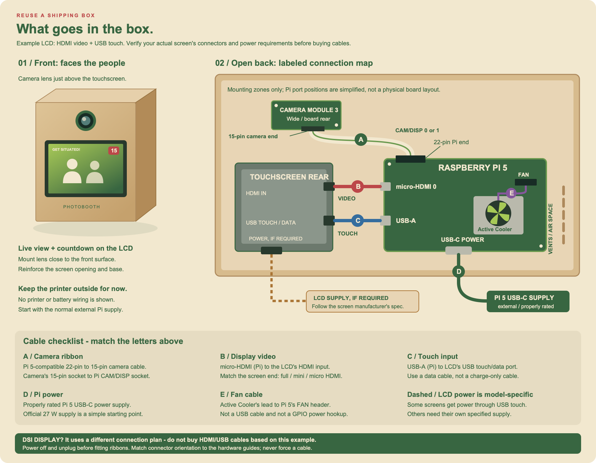

# Portable photobooth

Basic Python touchscreen app for a Raspberry Pi 5, a Raspberry Pi Camera Module,
and an LCD running the Raspberry Pi OS desktop.

## Target flow (latest design)

The LCD interface and camera capture should be separate programs. The LCD program
stays open for the entire session; its Submit button starts the capture program,
not another copy of the interface.

1. The LCD asks for **3 or 4 photos** and a **5 or 10 second interval between
   photos**.
2. The user taps **Submit** once. Lock the choices and disable Submit so another
   session cannot start while one is running.
3. Show **Get ready!** with a **15-second positioning countdown**, regardless of
   the selected interval. Prepare the camera during this stage; if it is not
   ready, show a preparation message rather than silently taking a failed shot.
4. Take and save photo 1 when the positioning countdown and camera preparation
   are complete. Do **not** add the selected 5/10-second interval before photo 1.
5. Show the selected 5/10-second countdown, then take and save the next photo.
   Repeat until exactly 3 or 4 photos have been saved. No further button presses
   are needed.
6. Compose a print image with two identical strips side by side, then return the
   LCD to a **Your photos are ready!** screen with a **Review** button.
   Do not display the photos until Review is tapped.
7. Review shows the saved photos one at a time in capture order, with
   **Next/Previous** controls. A 3-photo session shows only 3 photos.
8. Show **Print (coming soon)**, disabled for now. Do not send anything to a
   printer. **New session** returns to the choices without deleting saved photos.

Example: with 3 photos and a 5-second interval, the sequence is:

```text
Submit -> 15-second positioning countdown -> capture/save photo 1
       -> 5-second countdown -> capture/save photo 2
       -> 5-second countdown -> capture/save photo 3
       -> Review button -> view photos -> Print (disabled)
```

Capture and save time is additional to the countdowns. A capture failure must
show an error, preserve completed photos, and allow a new session; it must not
claim that the session completed successfully.

## How Submit triggers capture

A touchscreen tap is a normal Tkinter button click. Its `command` callback
reads the selected options and starts the session. There is no need to run a
terminal command for every session or click a physical button for each photo.
Launch the LCD app once at the beginning of use; Submit starts each photo session.

The proposed split is:

| Program | Responsibility |
| --- | --- |
| `lcd_ui.py` (planned) | Own the Tkinter window, choices, Submit callback, countdown display, Review, photo display, and disabled Print option. |
| `capture.py` (planned) | Own Picamera2, camera preparation, the initial 15-second wait, the selected inter-photo waits, JPEG saving, and session results. No Tkinter window. |

Use Python's `subprocess.Popen` from the Submit callback to launch `capture.py`
with validated photo-count and interval arguments, plus a unique output folder.
Use `sys.executable` so both programs use the same Python installation, and pass
arguments as a list without `shell=True`.

The capture program should send newline-delimited JSON status messages over
standard output: preparation, countdown updates, saved-photo paths, and
completion with the ordered list of paths. Send diagnostics to standard error
and exit nonzero on failure. The UI should display Review only after a successful
exit with the expected number of saved photos.

Read process messages off the Tkinter thread and use a queue polled with
`root.after(...)` to update widgets. Do not use `time.sleep()`, blocking pipe
reads, or a blocking process wait inside the Submit callback: these would freeze
the screen. Drain standard error too, detect unexpected exits, and clean up the
capture process and camera when the LCD app closes. The capture program owns
timing; the LCD only displays its countdown messages so two timers cannot drift.

**The program split is planned, not implemented.** The fixed 15-second countdown,
camera preparation during that wait, and live view already work in the current
single program. The planned filenames above do not exist yet.

## What works in the current code

- A cream-and-green options screen with large photo/timer choices, a live
  selection summary, and a Start photo session button. The palette uses
  `#386641`, `#6a994e`, `#a7c957`, `#f2e8cf`, and `#bc4749`.
- Choose 3 or 4 photos and a 5 or 10 second delay between photos.
- Press Start once. A fixed 15-second positioning countdown runs before photo 1.
  Only subsequent photos use the chosen 5/10-second delay, with no extra taps.
- The LCD shows a live camera view during positioning and between photos, with
  the countdown above it. Camera Module 3 continuous autofocus is enabled.
- After the final capture, automatically save `print_layout.png` containing two
  identical vertical strips side by side. Both 3-photo and 4-photo layouts use
  the same sheet size.
- Press Review after capture, then use Next/Previous to view the photos in order,
  one at a time. A 3-photo session shows 3 photos, not 4.
- Print is visible but disabled. **Nothing is sent to a printer yet.**
- New session returns to the choices without deleting saved photos.

Currently, both the LCD interface and capture logic live in `photobooth.py`.
The Start button calls `PhotoBooth.start()`, which creates the session and begins
the fixed 15-second positioning countdown. The selected interval applies only
between photos, not before photo 1.

There is no physical GPIO button support or retake button
in this first version. Use the LCD touchscreen or a mouse.

### What appears on the LCD?

**The LCD shows a live camera preview after Start**, during the 15-second
positioning countdown and between photos. The countdown stays above the image.
The camera starts on the background worker while the timer runs. If it is not
ready at zero, the screen says "Waiting for camera..." before taking photo 1.
The preview may pause briefly during a still capture; it stops after the final
shot. Review then shows the saved photos, not a live feed.

```text
CURRENT SCREEN FLOW
Options -> live view + 15-second countdown -> capture
        -> live view + 5/10-second countdown -> capture -> ...
        -> prepare print layout -> Review button -> saved photos
```

The preview preserves the full captured aspect ratio without mirroring or
stretching. It is downsampled to at most 640 x 360 and refreshed approximately
five times per second, depending on camera/processing speed. It is a framing aid,
not a guarantee of final exposure or focus. The print layout center-crops photos
further; print-crop guides are not implemented. Preview errors are displayed
explicitly and return to the options, preserving any completed photos.

## DIY box layout

Start with a sturdy reused shipping box, reinforced with a second layer of
cardboard around the screen and mounting points. These are **concept sketches,
not measured cutting templates**. Measure the actual LCD, Pi/cooler, connectors,
and cables before choosing the box or cutting holes. Keep the printer external
for this first build.



[Open the full-size illustration](./images/box-layout.svg).

### How to read the picture

- **Left: front view.** The camera and LCD both face the people. The lens sits
  just above the screen, near the front surface. Keep it near eye level when the
  box is on its table/stand. A deep or narrow opening can block a wide-angle
  view; check captured photos for dark corners.
- **Right: open back.** The camera board connects to the Pi with a gently curved
  ribbon. The screen sits behind the front panel. Put the Pi/cooler on a separate
  reinforced mount with air space and side vents; use the box depth so the screen
  and connectors do not collide. The drawing is not to scale.
- **Right-hand cable map:** each colored cable ends at a labeled connector.
  Letters A-E match the checklist below the drawing. Port locations are
  simplified to make the paths readable; this is not a physical Pi board map
  or ribbon-contact orientation guide.
- **Screen connections depend on the LCD.** The example specifically assumes
  an HDMI + USB touchscreen. A DSI screen uses a different connection plan;
  do not buy the illustrated display cables until the LCD model is confirmed.
- **Mounting:** support the LCD by its bezel or mounting points, not pressure on
  the glass. Use suitable Pi standoffs and camera board mounting points, keeping
  exposed contacts clear of metal. Do not press on the autofocus mechanism.
- **Access and power:** keep the back reopenable, allow access to the SD card
  and needed ports, and begin with external Pi power. Shut down and unplug before
  adjusting boards or cables. Do not sharply fold or pull the camera ribbon.

### Cables shown in the illustration

| Label | Connection | Cable / requirement |
| --- | --- | --- |
| A | Camera Module 3 Wide to Pi 5 CAM/DISP 0 or 1 | Pi 5-compatible **22-pin-to-15-pin camera ribbon**: 15-pin end at the camera, 22-pin end at the Pi. |
| B | Pi micro-HDMI 0 to LCD HDMI input | **micro-HDMI at the Pi**, with an HDMI connector matching the LCD at the other end. This carries the picture, not USB touch input or screen power. |
| C | Pi USB-A to LCD USB touch/data input | A **data-capable USB cable** with the correct screen-side connector. Depending on the LCD, this may also supply its power. |
| D | External supply to Pi USB-C power port | A properly rated Pi 5 supply; the official **27 W USB-C supply** is a straightforward starting point. |
| E | Active Cooler to Pi FAN header | The cooler's own fan lead; do not substitute a USB cable or improvise GPIO wiring. |
| Dashed | Optional external LCD supply to its power input | Only if required by that screen. Use its specified voltage, polarity, connector, and power rating; do not assume any USB port can power it. |

Use the camera and display manufacturers' installation guides for ribbon
orientation and port identification. A camera ribbon and a display ribbon are
not interchangeable just because their connectors look similar. The picture
does not specify mains wiring, a battery system, or a printer power connection.

### Build in this order

1. Lay the components on a table and connect/test them before enclosing anything.
2. Mark the front camera and screen positions on scrap cardboard. Check cable
   reach, finger access, and camera framing before cutting the final panel.
3. Reinforce the box, add mounts, and make the display, lens, cable, and vent
   openings. Cut/drill with all electronics removed; clear debris before assembly.
4. Install and secure the components, leaving the back open for the first tests.
   Start with the normal external Pi power supply rather than improvised wiring.
5. Test touch controls, captured-image framing, stability, and cooling with the
   box closed before carrying it around. Do not treat cardboard as weatherproof
   or leave a powered prototype unattended.

Do not add a carrying handle to thin cardboard without reinforcing its attachment
points. Carry the first prototype from underneath. A future integrated printer
would need a larger enclosure, separate power planning, service access, and the
manufacturer's required front/rear paper-path clearance.

## Raspberry Pi setup

Use Raspberry Pi OS Bookworm or newer with a desktop session. Connect the camera
with the Pi powered off, then boot and verify it:

```sh
rpicam-still -o camera-test.jpg
sudo apt update
sudo apt install python3-picamera2 python3-pil python3-pil.imagetk python3-tk
```

Copy this folder onto the Pi, open a terminal on its desktop, and run:

```sh
cd portable-photobooth
python3 photobooth.py --fullscreen
```

Use the system Python, since Picamera2 is installed by apt. An SSH-only/headless
session cannot show the LCD interface without a configured graphical display.
Close other camera applications before starting.

Press Escape to leave fullscreen; close the window to quit.
Photos are saved under `photos/<timestamp>_<unique-id>/photo_01.jpg`, etc.,
beside the script. Each session has a separate folder. To choose another location:

```sh
python3 photobooth.py --output /home/pi/Pictures/photobooth
```

The timer starts again after each capture completes, so capture time is additional
to the selected delay. Camera initialization and about two seconds of exposure
settling happen during positioning. Slow initialization may extend the wait
beyond 15 seconds. Preview, capture, and cleanup share one worker thread so they
cannot access Picamera2 concurrently; Tk image updates happen on the UI thread.
Failed previews/captures display an error; completed photos remain on disk.
Photos are not automatically deleted, so monitor available storage.

## Print layout and future printing

Each completed session saves its original JPEGs plus `print_layout.png`: a
**1,200 x 1,800 pixel RGB image at 300 DPI**, intended for a 4 x 6-inch sheet in
portrait orientation. Each half is a 600 x 1,800 pixel strip (nominally 2 x 6
inches). Cut the printed sheet vertically down the center to separate the copies;
this is not continuous-roll printing or automatic cutting.

The photos appear top to bottom in capture order, with white borders and gaps.
Three-photo layouts use taller slots; four-photo layouts use shorter slots.
Photos are EXIF-oriented and center-cropped to fill their slots without stretching.
Keep faces near the center, as edges may be cropped. Original JPEGs are unchanged,
and individual-photo Review still shows the originals rather than the print crop.

Composition runs on the camera worker after all captures, before Review appears.
A layout failure displays an error but leaves the originals available for Review;
it does not indicate that a print layout was successfully generated.

Actual wireless printing requires the printer make/model and its supported
interface. Some portable printers use vendor-only apps rather than a standard
Linux print queue. Submit the composed sheet as **one print job**, not each photo
as a separate job. Paper dimensions, scaling, borderless overscan, margins, and
cutting behavior must be confirmed for the printer. DPI metadata alone does not
force physical print dimensions. Print remains disabled: no jobs are submitted.

## Basic tests

For step-by-step hardware and software checks, follow the
[phased testing guide](./TESTING.md). It separates current functionality from
future split-program and printer tests.

```sh
python3 -m unittest -v
```

These tests check option validation, ordered saves, exact photo counts, camera
failure handling, layout dimensions/DPI, duplicate strips, photo order,
orientation, preserved originals, and layout error handling without camera
hardware. Pillow and Tkinter must be installed. Touchscreen layout, actual
countdown timing, and Picamera2 capture still need testing on the Pi.

## Next milestones

Inspired by overtinker's portable photobooth, with different controls and flow.

1. Set up Raspberry Pi 5 access and test the camera and LCD independently.
2. Split the LCD and capture programs as described above, preserving the fixed
   15-second positioning countdown, live view, and background camera preparation.
3. Test the complete 3/4-photo flow, countdowns, saved files, Review, and recovery
   from camera errors on the Pi.
4. Confirm the printer model and paper dimensions, test the composed strip
   layout on paper, and implement wireless printing. Keep Print disabled until
   this works.
5. Build a ventilated case with a handle.

A physical GPIO start/confirm/reject button is a possible later addition, not
required for the touchscreen Submit flow. Retake and single/double-click
hardware controls are not implemented.